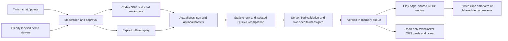

# Boss Forge

**Chat designs the boss, Codex builds it, the streamer fights it.**

A Codex x TwitchCon hackathon project by [ayushagarwalhere](https://github.com/ayushagarwalhere). Viewers will describe bullet-hell bosses; the runtime forge will write code, check fairness, and queue a fight for the streamer.

## Current milestone: M5

Four playable house bosses, a deterministic 60 Hz simulation, original procedural art and WebAudio sound, keyboard/gamepad controls, and an independent fairness gate. The Codex forge includes streamed progress, moderation, approvals, three attempts, server revalidation and queued fights. Twitch chat/Channel Points, refunds, highlights and the transparent OBS overlay work alongside an account-free replay demo. Optional generator scripts compile in an isolated interpreter into commands that the same gate and game simulate.

All four house bosses pass the gate at standard difficulty. Replay mode and simulated events stay visibly labeled. Live Twitch accounts, stream highlights and the native Windows Codex sandbox still need operator verification; they are not claimed as live-tested. The included script example and adversarial sandbox tests run locally without credentials. See the [recording and submission runbook](docs/demo.md).

## Run locally

Use Node 20.19+, 22.13+, or 24+ (latest Node 22 recommended; `.nvmrc` supplied) and npm.

```sh
npm ci
npm run demo
```

Open **http://127.0.0.1:8787/forge/** for the console and **http://127.0.0.1:8787/play/** for gameplay. Simulated viewers send varied requests every 20 seconds. The forge builds/replays ahead while the streamer fights. In the arena, click **Fight next forged boss**, then **Enter arena**. If the queue is empty, the server uses a verified house fallback. The console can skip an abandoned active fight.

With no key, demo mode replays recorded, known-good house templates and independently reruns the gate. It does not synthesize new code or pretend to interpret arbitrary text with a live model. With `CODEX_API_KEY` or `OPENAI_API_KEY` set in `.env.local`, demo mode uses the real Codex pipeline and can incur model usage. Set `FORGE_MODE=replay` to explicitly keep a key-equipped machine offline. No key or Twitch account is needed for replay.

For live, manually approved local requests, set a key and run `npm run server`. The installed SDK is `@openai/codex-sdk@0.166.0`; it uses its bundled Codex CLI. The runtime uses a strict workspace-write permission profile with no tool network and denied outside reads. **Native Windows live mode needs MXC or a configured elevated sandbox.** The adapter prefers MXC, with elevated as its legacy fallback; it never uses the unelevated mode that lacks denied reads. The smoke test's selected default backend rejected restricted reads, so native live execution remains unverified here. No system sandbox settings were changed. See [forge setup and verification limits](docs/forge.md).

`npm run dev` serves house-only frontend development at http://localhost:5173/play/; the integrated server is needed for connected forge controls. The server binds to loopback; set `PORT` to change 8787. API moderation uses `MODERATION_API_KEY` or `OPENAI_API_KEY`, with `MODERATION_MODE=api`. Flagged, malformed, timed-out or failed checks admit no job. Without a platform key, **manual mode** is clearly labeled and always requires approval for viewer requests, even with `AUTO_APPROVE=true`. Auto-approval applies only to API-passed requests; trusted simulated demo ideas bypass API checks and stay labeled. Codex-only keys are not assumed to authorize the moderation API.

| Control | Action |
| --- | --- |
| WASD / arrows | Move; diagonal movement is normalized |
| Shift | Focus: slower movement and visible 4 px hitbox |
| P / Escape | Pause / resume |
| R / Reset | Return to the selected boss intro with the same seed |
| Sound off/on | Opt into original synthesized cues; saved locally |
| Gamepad left stick / D-pad | Move |
| Gamepad south button / left trigger | Focus |

Autofire aims at minions first, then the boss. Losing keyboard/window focus pauses the fight. A retry uses the same seed and difficulty. Changing boss, seed, or difficulty resets the round. The same seed **and the same per-tick inputs** reproduce the fight; aimed patterns respond to where you move. Select Relaxed (75%), Standard (100%), or Intense (125%) for projectile/movement speed and attack cadence. Settings last for the current page session.

The game page accepts input and can be captured in OBS. Add `http://127.0.0.1:8787/overlay/` as a separate **1920×1080 transparent Browser Source** for boss cards, queue, ticker and toasts. It works with account-free demo viewers. Forged cards show the server's report at standard difficulty; changing the difficulty does not certify that new setting.

## Connect Twitch

Set the Twitch client ID/secret in ignored `.env.local`, register `http://localhost:8787/auth/callback`, stop the server, then run `npm run auth -- broadcaster` and `npm run auth -- bot`. Set `TWITCH_ENABLED=true` and restart with `npm run server`. Demo always disconnects Twitch. See [Twitch and OBS setup](docs/twitch.md) for token ownership/scopes, reward eligibility, refund recovery and live verification limits.

Viewers use **`!boss <description>`** or the app-created **Forge a Boss** points reward. **`!queue`** lists verified bosses. Broadcasters/moderators can use **`!approve <request-id>`**, **`!reject <request-id>`** and **`!skip`**; the local console keeps its approval controls. Requests still need approval unless `AUTO_APPROVE=true`. Unavailable Channel Points leave chat intake usable. Rejected/failed reward requests are refunded; successful redemptions are fulfilled only after the server's gate pass. A finished server-claimed fight requests a clip and marker, with honest pending/offline toasts.

## Checks

```sh
npm run check            # lint, app + DOM-free engine types, tests, house specs
npm run build            # production pages in dist/web
npm run schema:export    # regenerate all three JSON Schemas
npm run bosses:validate  # schema validation only; not a fairness claim
npm run gate -- ember-anvil
npm run gate -- --all    # all four house bosses
npm run gate -- bosses/examples/scripted/boss.json
npm run demo:record      # regenerate offline replay fixtures after house/policy changes
```

Validate a custom spec: `npm run bosses:validate -- path/to/boss.json` (nonzero exit on invalid JSON/schema). CI runs checks/build/schema drift checks on Node 20 and 22. Replay tests compare state hashes across seeded input sequences and JSON save/restore, alongside collision, telegraph, phase, minion, cap, and command scheduler tests.

## Fairness gate

`npm run gate -- <id>` finds `forge/<id>/boss.json` first, then `bosses/house/<id>.json`. Explicit JSON paths also work, for example `npm run gate -- tests/fixtures/unfair-boss.json`. `--all` runs the complete house collection. In Windows PowerShell, use `npm.cmd` if the `npm.ps1` wrapper drops `--` arguments.

The CLI prints a GateReport JSON to stdout and a short summary to stderr, saves reports in `.artifacts/gates/`, and also writes `forge/<id>/gate-report.json` for runtime bosses. Exit code **0 means pass; 1 means rejection or an error**. For JSON-only stdout, use `npm --silent run gate -- ember-anvil`. A neighboring generator is statically checked, compiled in a resource-limited QuickJS worker, and included in the actual gated spec. Hand-authored inline tapes and cached pass claims are rejected.

The fixed policy requires >=25% safe space in every rolling half-second window, >=350 ms laser/charge warnings, targeted bullets <=300 px/s, <=400 live bullets without dropped overflow, a 45–120s estimated TTK, 2–4 bot wins with at least one actual death across five seeds, zero exceptions, and a 99th-percentile measured sim tick within 16.67 ms (one OS/GC stall cannot reject a boss). Five additional invulnerable damage probes must kill and cover every phase. No supplied report or claimed pass is trusted.

| House boss | Bot wins | Worst safe space | Median probe TTK |
| --- | --- | --- | --- |
| Ember Anvil | 2/5 | 34.7% | ~80s |
| Neon Brood | 4/5 | 30.1% | ~91s |
| Prism Warden | 4/5 | 49.3% | ~86s |
| Brass Serpent | 2/5 | ~33% | ~87s |

These results use policy `m5-v1`, standard difficulty and the checked-in specs. The M5 version adds script commands and overflow accounting without changing seeds, bot skill or fairness thresholds. Gameplay is repeatable in the same JS runtime; host timing can independently reject a run. Reports identify the actual spec and compiled commands with SHA-256. They are diagnostics, not proof of balance for every human. See [gate definitions](docs/fairness.md) and [script isolation](docs/scripts.md).

## Layout

| Path | Responsibility |
| --- | --- |
| `engine/constants.ts` | Shared 960x720 arena, tick rate, player constants, caps |
| `engine/boss-api.ts` | Zod boss/command schemas and TypeScript API |
| `engine/simulation.ts` | Fixed-step movement, attacks, collision, HP, phases, outcomes |
| `engine/random.ts` | Explicit serializable seeded RNG |
| `engine/dodger.ts`, `engine/fairness-policy.ts` | Shared reference bot and immutable gate limits/seeds |
| `engine/gate-report.ts` | Portable Zod report contract and generated JSON Schema |
| `engine/choreography.ts` | Trusted generator command factories and tick scheduler draft |
| `web/play/` | Streamer play page, renderer, effects, input, house-spec imports |
| `web/overlay/` | Transparent OBS boss cards, queue, ticker and toasts |
| `bosses/house/` | Ember Anvil (heavy), Neon Brood (swarm), Prism Warden (sniper) |
| `server/gate/` | Authoritative runner, rolling safe-space metrics, file/report handling |
| `server/forge/` | Codex SDK adapter, workspace isolation, revisions, queue, metadata |
| `server/twitch/` | OAuth ownership/refresh, Helix, EventSub, commands, rewards and highlights |
| `server/scripts/`, `server/moderation.ts` | Isolated command compilation and request admission |
| `server/demo/`, `bosses/replays/` | Simulated viewers and explicitly offline recorded fixtures |
| `web/forge/`, `web/shared/` | Local forge console and typed WebSocket client |
| `forge/` | Runtime agent rules and ignored per-request workspaces |

All boss shapes, bullet art and effects are procedural; sounds use original oscillator envelopes. No downloaded game assets, third-party fonts, game IP or recorded music are included. MIT licensed; see [LICENSE](LICENSE). Dependency licenses remain with their respective packages.

## Simulation and BossAPI v1

`engine/boss-api.ts` is authoritative. Strict objects reject unknown fields. Positions use arena pixels; intervals/summon cadence use seconds; warnings/modifiers use milliseconds; angles use degrees (90 points down). Start phases at `hpBelow: 1`, then strictly descend; the last matching threshold applies inclusively and replaces the previous phase. Old pending warnings/lasers are canceled on phase changes; existing bullets and minions persist.

Bullet emitters use count, speed, acceleration, spin, gap, interval, warning, shape, color, and bounce. Lasers have their own width, length, active duration, aim mode, fixed angle, sweep, interval, warning, and color. Laser origin/heading lock when the warning begins; a sweeping warning displays the entire swept sector. Minions have explicit HP and a 12-entity live cap; enemy bullets cap at 400, pending volleys at 32, and lasers at 16. Excess spawns are dropped. Bullets expire after ten combat seconds.

The engine implements all schema movement/emitter/minion kinds. Phase modifiers activate once at phase entry for their declared duration. Darkness is a visual visibility mask; shrinkArena clamps movement bounds. Shields reduce damage; minionsFirst blocks boss damage while minions survive; coreOpenAfterLaser grants full damage for two seconds after a beam (half damage while closed); back reduces frontal damage to a quarter. These rules are tunable before M2 balance verification.

`createGame(spec, seed, difficulty)` validates and owns a copy of the spec. `stepGame(state, input)` mutates one fixed input step; `stateHash(state)` hashes serializable state, including RNG and pending attacks. Intro and hit-stop consume input steps while holding the combat clock. Browser wall-clock time only feeds an accumulator; pausing/hidden tabs clear the accumulator and keys. Headless callers supply the same input sequence directly. Replay equality targets the same JavaScript runtime; cross-runtime floating-point bit identity is not promised.

All three JSON Schemas are generated: `engine/boss.schema.json`, `engine/boss-command.schema.json`, and `engine/gate-report.schema.json`. Structural schema validity must be followed by the Zod phase-order check, then the independent fairness gate before a runtime boss can run.

### Generator choreography

```ts
import type { BossScript } from './engine/boss-api';

export const script: BossScript = function* (api) {
  yield api.say('Eyes up.');
  yield api.telegraph(480, 180, 40, 500);
  yield api.wait(500);
  yield api.moveTo(240, 180, 1000);
  yield api.wait(1000);
};
```

`api.emit`, `moveTo`, `wait`, `say`, and `telegraph` return commands for `yield`; `api.rand()` reads seeded randomness. No Promises or wall clocks are used. A trusted `CommandStepper` validates and yields at most 16 commands per tick by default. `wait` rounds up to whole sim ticks, with zero waiting until the next tick. `moveTo` schedules movement and does not itself wait. The import above is a host-side type illustration; future generated boss scripts may not import anything.

The host-side scheduler above is for trusted examples. Actual boss.ts files use an untyped `export function* script(api)` without imports, pass a conservative syntax checker, and execute in QuickJS WebAssembly inside a killable worker. Guest CPU, heap and stack are bounded. At most 512 commands are compiled, with 16 per tick over a 120-second horizon. Only the validated tape reaches the browser; raw generated JavaScript never runs in the sim. See [the supported subset, semantics and limits](docs/scripts.md).

## Milestones

- [x] M0: setup + schema + three house specs
- [x] M1: deterministic engine and playable canvas game
- [x] M2: reference dodger, metrics, independent fairness gate
- [x] M3: Codex forge adapter, streamed events, queue, no-account replay demo
- [x] M4: Twitch auth/EventSub/Helix and OBS overlay (live operator verification pending)
- [x] M5: original sound, moderation, isolated choreography, fourth house boss and submission runbook

## Architecture



## How we used Codex

At build time, Codex helped implement the typed contract, deterministic engine, reference bot, gate, runtime forge, Twitch adapter, overlay, moderation, isolated compiler and tests in reviewed milestones. Repository history also includes collaborator contributions to the landing page, motion and gate timing. Commits use the entrant's requested identity; generated assistance is documented here rather than hidden.

At runtime, the installed Codex SDK starts a real thread in a restricted per-boss workspace, streams sanitized progress, writes JSON/optional finite choreography, runs the gate and revises against authoritative diagnostics. It can use up to three turns on the same thread. The server independently recompiles/rechecks the actual files and queues only its verified memory snapshot. Source quotes are data, never agent instructions. Runtime tool networking and outside reads remain denied.

Offline replay runs no Codex SDK thread and invents no thread IDs. Its fixtures record house-template work, not model generation. Native Windows live isolation and authenticated Twitch/OpenAI delivery still require operator testing. The final video/Devpost submission and the optional Rematch Patch stretch are not claimed complete.

Integration verification notes are in [docs/integrations.md](docs/integrations.md). Future server credentials belong in `.env.local`, based on `.env.example`; never commit tokens or put them in `VITE_` variables.
